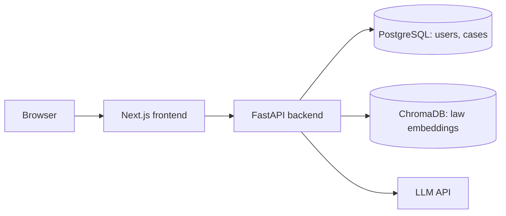

# Neethivaan — AI-Powered Legal Grievance & Awareness Platform

[](https://github.com/NISHANTH-S-06/neethivaan-ai/actions/workflows/ci.yml)

Helps citizens understand legal processes, file and track complaints (FIR/CSR references), and get step-by-step guidance, with an AI assistant grounded in Indian law texts (RAG).


## Features
- Citizen and admin roles with JWT authentication
- Complaint filing and case tracking
- AI legal assistant using Retrieval-Augmented Generation (ChromaDB + embeddings over IPC and other law texts)
- Case analysis with NLP / case-based reasoning over prior judgments
- Document upload and storage

## Tech stack
Next.js 15 (App Router, TypeScript, Tailwind) · FastAPI · PostgreSQL + Alembic · ChromaDB · Docker + Nginx

## Architecture


## Run locally
```bash
cp .env.example .env        # set SECRET_KEY, POSTGRES_PASSWORD (same value in DATABASE_URL), LLM API key
docker compose up -d        # database + backend
cd frontend && npm install && npm run dev   # http://localhost:3000
```
API docs: http://localhost:8000/docs

## Tests
```bash
pip install -r backend/requirements.txt pytest
pytest backend/tests          # run from the repo root
```

## What I learned
RAG chunking and retrieval ranking, role-based auth, containerised deployment.

## Security notes
- Everyone registers as a citizen; lawyer/admin roles are granted by an admin only
- Only a complaint's owner or an admin can modify it or add attachments; suspended accounts are rejected
- Secrets come from environment variables (`.env`, never committed)

## Disclaimer
Educational project. Not legal advice. Uses only sample/dummy data.
